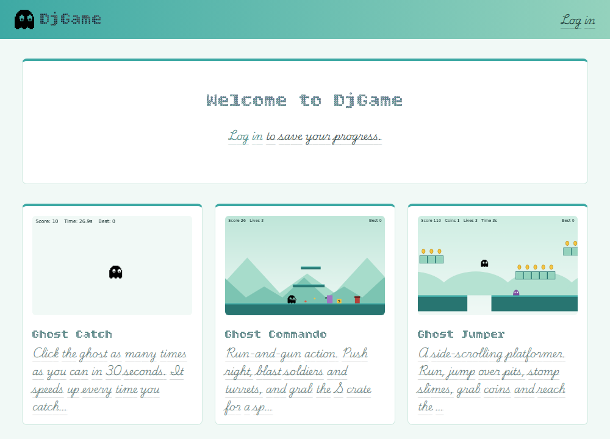

# DjGame

A Django website for playing browser games. Each game is plain JavaScript stored in the database, so you can add or edit a game from the Django admin without deploying anything. Players can sign up, and their progress is saved separately for every game.



## Features

- **Game library**: the home page lists every active game with a thumbnail. Each game plays on its own page.
- **Included games**:
  - **Ghost Catch**: click the ghost as many times as you can in 30 seconds.
  - **Ghost Jumper**: a side-scrolling platformer with pits, coins, slimes to stomp and a flag to reach.
  - **Ghost Commando**: a run-and-gun shooter with 8-direction aiming, turrets and a spread-shot power-up.
- **Accounts**: sign up, log in and out, and a profile page showing saved progress for each game.
- **Saved progress**: games store any JSON per player per game through a small JavaScript API (`DjGame.load()` / `DjGame.save()`).
- **Games managed in the admin**: paste a game's JavaScript, upload a thumbnail, and switch games on or off.

## Tech stack

- Python 3.12, Django 6.1
- [django-split-settings](https://github.com/wemake-services/django-split-settings) for per-environment settings
- SQLite
- Plain JavaScript and the HTML canvas, with no front-end build step

## Getting started

```bash
git clone https://github.com/srikantsingh673/django-game.git
cd django-game

python3 -m venv .venv
source .venv/bin/activate          # Windows: .venv\Scripts\activate
pip install -r requirements.txt

python manage.py migrate
python manage.py createsuperuser   # your own admin account
python manage.py runserver
```

Open <http://127.0.0.1:8000/> to play, and <http://127.0.0.1:8000/admin/> to manage games.

The repository includes `db.sqlite3` with the sample games already loaded, so they're playable straight away.

## Project structure

```
djgame/                     Django project package
├── settings/
│   ├── __init__.py         shared settings; loads env_<environment>.py
│   └── env_dev.py          development settings (secret key, DEBUG, database, email)
├── urls.py
└── apps/
    ├── base/               ModelAbstractBase: `created` / `updated` timestamps for every model
    ├── account/api/        login, logout, register and profile views
    └── game/
        ├── models/         Game (with its JavaScript code) and GameData (saved progress)
        ├── api/            library, play page, game script and save views
        ├── migrations/
        └── templates/game/
templates/                  site layout, login, sign-up and profile pages
static/
├── css/                    site theme and admin theme
└── js/
    ├── main.js             site-wide scripts (show/hide password button)
    └── game-sdk.js         the DjGame API available to every game
media/                      uploaded thumbnails
```

The `account` and `game` apps keep one view class per file in `api/views/`, and their routes in `api/urls.py`.

## Configuration

Settings are split by environment. `djgame/settings/__init__.py` holds everything shared and then loads `env_<name>.py`, where `<name>` comes from the `DJGAME_ENVIRONMENT` environment variable (the default is `dev`).

To add a production configuration:

1. Create `djgame/settings/env_prod.py` defining `SECRET_KEY`, `DEBUG = False`, `ALLOWED_HOSTS`, `DATABASES` and `MAILERS`.
2. Run with `DJGAME_ENVIRONMENT=prod`.

The secret key in `env_dev.py` is for local development only. Never use it in production.

Uploaded thumbnails go to `media/`. Django serves them only while `DEBUG` is on. In production, have your web server serve `/media/` and the collected static files.

## Adding a game

1. In the admin, go to **Games → Add game**.
2. Enter a title (the slug fills itself in), a description and an optional thumbnail (PNG, JPG, GIF or WebP).
3. Paste the game's JavaScript into **Code** and save. The game appears on the home page at `/games/<slug>/`.

A game's code runs on its play page and draws on an 800×500 canvas. It gets this API:

```js
DjGame.canvas              // the <canvas> to draw on (800×500)
DjGame.loggedIn            // true when a player is logged in
await DjGame.load()        // this player's saved JSON for this game, or null
await DjGame.save(state)   // store any JSON; true once saved (always false for guests)
```

A complete minimal game:

```js
// Click counter: the smallest possible DjGame game.
const ctx = DjGame.canvas.getContext('2d');
let clicks = 0;

function draw() {
    ctx.clearRect(0, 0, DjGame.canvas.width, DjGame.canvas.height);
    ctx.font = '32px sans-serif';
    ctx.fillText(`Clicks: ${clicks}`, 40, 80);
}

DjGame.load().then(data => {                  // null for guests or first-time players
    clicks = data?.clicks || 0;
    draw();
});

DjGame.canvas.addEventListener('pointerdown', () => {
    clicks++;
    DjGame.save({ clicks });                   // does nothing for guests
    draw();
});

draw();
```

Tips:

- **Host images on this site** (in `static/` or as an upload) and load them by path, e.g. `/static/assets/ghost.png`. Many image sites block their images from being shown on other sites. Drawing an image that failed to load throws an error and stops the game loop.
- **The canvas is scaled to fit the page.** Convert pointer positions with `getBoundingClientRect()`, as the included games do.
- **Stop the page scrolling** on arrow keys or Space by calling `preventDefault()` in your key handlers.

> **Security:** a game's code runs on the site with the logged-in player's session. Only give the "change game" permission to people you trust with your players' accounts.

## URLs

| URL | Purpose |
|---|---|
| `/` | Game library |
| `/games/<slug>/` | Play a game |
| `/games/<slug>/game.js` | The game's JavaScript, served from the database |
| `/games/<slug>/save/` | `GET` loads and `PUT` saves the player's JSON. Requires login (401 otherwise) and a CSRF token |
| `/account/register/` | Sign up |
| `/account/login/` | Log in |
| `/account/logout/` | Log out (POST) |
| `/account/profile/` | Account details and saved progress |
| `/admin/` | Django admin |
